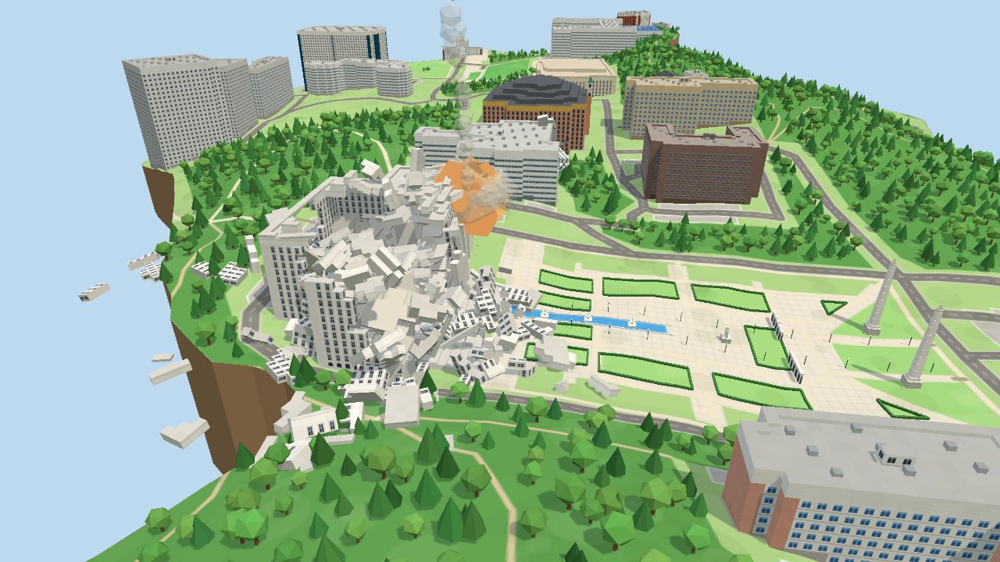

# khu-global-smash

시험기간 스트레스를 경희대학교 국제캠퍼스에 푸는 3D 파괴 시뮬레이션. 브라우저에서 돌아가는 PC용 샌드박스입니다.



## 특징

- **실제 캠퍼스 지도:** OpenStreetMap의 캠퍼스 경계 안에 있는 건물·도로·녹지와 NASA SRTM 표고로 만들었습니다. 언덕은 실제보다 1.5배 높게 보이게 했습니다.
- **건물:** 건물 41개를 사진을 참고해 색과 외관을 입혔습니다. 정문·노천극장·천문대는 전용 모델이고, 중앙도서관 앞 사색의 광장도 꾸몄습니다. 외부 3D 모델 없이 모두 코드로 만듭니다.
- **파괴:** 약 5.4만 개의 블록으로 된 건물이 벽판·바닥판·기둥 같은 덩어리 단위로 무너져 쌓입니다(Rapier 물리). 덩어리는 시작할 때와 리셋할 때마다 무작위로 새로 나뉩니다.
- **미사일:** 포물선으로 날아가 터지며 불덩이·먼지·연기·섬광·화면 흔들림이 납니다. 효과음은 음원 파일 없이 Web Audio로 합성합니다.
- **땅:** 땅에 맞으면 살짝 파이고 그을음이 남으며, 그 자리의 나무는 날아갑니다.
- **파괴율:** 전체 파괴율과 많이 부서진 건물 5곳을 보여 줍니다.

## 조작

| 입력 | 동작 |
|---|---|
| 클릭 | 미사일 발사 |
| 왼쪽 드래그 | 이동 |
| 오른쪽 드래그 | 회전 |
| 휠 | 확대·축소 (커서 쪽으로) |
| 1~9 | 무기 고르기 (지금은 1번 미사일뿐) |
| R | 리셋 |

오른쪽 위 패널에서 바꿀 수 있는 것:

| 설정 | 범위 (기본) | 설명 |
|---|---|---|
| 폭발 반경 | 6~48m (24m) | 커질수록 파편이 세게 날고 연출·소리도 커집니다 |
| 미사일 속도 | 0.25~3배 (1배) | |
| 잔해 소멸 | 0~9번, 불가 (4번) | 잔해가 된 뒤 폭발에 몇 번 더 휘말리면 가루로 사라질지. 0번은 멈추자마자 사라지고, 불가는 폭심 바로 옆이 아니면 남습니다 |
| 음량 | 0~100% (50%) | |

## 실행

Node.js 20.19 이상(또는 22.12 이상)이 필요합니다.

```bash
npm install
npm run dev
```

터미널에 나온 주소(기본 http://localhost:5173)를 브라우저에서 엽니다. 배포용 빌드는 `npm run build`이며 결과는 `dist/`에 생깁니다.

내장 그래픽을 기준으로 맞췄습니다. 화면이 느려지면 렌더링 해상도를 자동으로 낮추고, 여유가 생기면 다시 올립니다.

## 지도 수정

지도 데이터는 `campus.json`에 들어 있습니다(커밋됨). 원본을 다시 받으려면 아래 명령을 실행합니다. 1~2분이 걸리고 네트워크가 필요합니다.

```bash
npm run fetch-osm
```

다시 받아도 `overrides.json`은 바뀌지 않고, `campus.json`에 직접 적어 둔 건물 이름도 유지됩니다(OSM에 이름이 없는 건물만).

`overrides.json`에서 바꿀 수 있는 것:

- `floors`: 건물 이름 또는 OSM id(`w…`/`r…`) → 층수. id가 이름보다 우선합니다. 적지 않은 건물은 OSM의 `building:levels`를 쓰고, 그것도 없으면 2층입니다.
- `add`: 지도에 빠진 건물을 추가합니다. `outline`은 `[위도, 경도]` 꼭짓점 목록입니다(구글 지도에서 우클릭해 복사한 좌표 그대로).
  ```json
  "add": [{ "name": "새 건물", "floors": 3, "outline": [[37.2401, 127.0801], [37.2403, 127.0805], [37.2399, 127.0807]] }]
  ```
- `remove`: 빼고 싶은 건물 이름 또는 OSM id.

이름이 없는 건물에 이름을 붙이려면 `campus.json`에서 그 건물의 `"name"`을 채웁니다.

## 파일 구성

| 파일 | 내용 |
|---|---|
| `main.js` | 장면·지형·카메라, 패널·핫바·키 입력, 땅 파임, 해상도 자동 조절 |
| `buildings.js` | 건물 블록 만들기, 외관 텍스처, 전용 모델(정문·노천극장·천문대) |
| `physics.js` | 파괴 물리: 덩어리 나누기, 떨어져 나간 조각, 잔해 |
| `tools.js` | 미사일, 폭발 연출, 효과음 |
| `scripts/fetch-osm.mjs` | OSM·표고 데이터를 받아 `campus.json` 만들기 |
| `campus.json` / `overrides.json` | 지도 데이터 / 손으로 고치는 값 |

## 알려진 한계

- 맞은 곳만 부서집니다. 아래층이 사라져도 위층은 떠 있습니다.
- 땅이 파인 모양은 화면에만 보이고 물리 지형은 그대로라, 파인 곳에 떨어진 잔해는 조금 떠 보일 수 있습니다.
- 미사일은 날아가는 길에 있는 건물을 뚫고 지나갑니다.
- PC(마우스·키보드) 전용입니다.

## 데이터 출처와 라이선스

- 코드: [MIT](LICENSE)
- 지도: © [OpenStreetMap](https://www.openstreetmap.org/copyright) contributors, [ODbL 1.0](https://opendatacommons.org/licenses/odbl/) (캠퍼스 경계 relation 11246784 안쪽). `campus.json`은 MIT가 아니라 ODbL을 따릅니다.
- 표고: NASA SRTM 30m (공공 영역), [OpenTopoData](https://www.opentopodata.org/) API로 받음
